  

# 🛡️ Awesome Verified Publisher & Team Identity 🌟

  
  
  
  
  

> 🔍 **A curated catalog of verified publisher, domain ownership, and team identity verification solutions.**  
> Explore top enterprise SaaS platforms and self-hosted open-source software for software supply chain security, domain validation, enterprise trust badges, and cryptographic identity attestation.  
> 🌟 **Star this repository if you find it valuable!** 🌟

---

## 📑 Table of Contents

- [🌐 Sector Overview & Market Dynamics](#-sector-overview--market-dynamics)
- [🏢 SaaS & Hosted Commercial Platforms](#-saas--hosted-commercial-platforms)
- [🔓 Open-Source Software & Toolkits](#-open-source-software--toolkits)
- [📊 Feature Comparison Matrix](#-feature-comparison-matrix)
- [🤝 Contributing Guidelines](#-contributing-guidelines)
- [💖 Support & Sponsorship](#-support--sponsorship)
- [📈 Star History](#star-history)
- [📜 License](#-license)

---

## 🌐 Sector Overview & Market Dynamics

The global identity verification and digital publisher trust market is projected to expand from approximately **$12.5 billion in 2024 to over $35 billion by 2032** (growing at a compound annual growth rate of ~15–18%). The sector exhibits **moderate-to-high fragmentation** across functional sub-segments—where established commercial credit bureaus (such as Dun & Bradstreet) and public certificate authorities (like Sectigo) dominate organizational identity proofing, whereas developer ecosystem publishers (GitHub, PyPI, Postman) operate as high-gravity, walled-garden trust authorities with winner-take-all dynamics in their proprietary developer workflows.

---

## 🏢 SaaS & Hosted Commercial Platforms

Below is a detailed benchmark of leading commercial, cloud-hosted Verified Publisher and Team Identity services. Sorted in descending order by parent company scale (valuation or enterprise revenue).

| Platform / Provider | Focus / Verification Type | Scale / Valuation / Revenue | Starting Tier Pricing | Free Tier / Trial Limits | Key Capabilities |
|:--------------------|:--------------------------|:----------------------------|:----------------------|:-------------------------|:-----------------|
| **[GitHub Verified Organization](https://github.com)** | Domain-based organization trust badge | **~$100B+ Valuation** *(Microsoft subsidiary; Microsoft $3.1T cap)* | **$4/user/month** *(GitHub Team plan)* | **Free forever plan:** Unlimited public & private repositories, domain verification supported, 2,000 CI/CD Actions mins/month, 500MB Packages storage. | Cryptographic DNS TXT verification, profile verification checkmark, restricted email notification routing. |
| **[X Verified Organizations](https://verified.x.com)** | Commercial organizational verification badge | **~$19B - $44B Valuation** *(Acquired $44B; secondary market valuation ~$19B)* | **$200/month** *(Basic tier; Full Access tier is $1,000/month)* | **No free plan / No free trial:** Immediate payment required; 0 free days; includes $200/mo ad credits on Basic. | Gold checkmark badge, affiliated sub-accounts, impersonation defense, priority support routing. |
| **[Postman Domain Verification](https://www.postman.com)** | Team workspace domain capture & SSO | **$5.6B Valuation** *(Series D valuation)* | **$14/user/month** *(Basic Team plan billed annually)* | **Free forever plan:** Up to 3 team members, unlimited shared workspaces, basic collections; domain capture requires Enterprise contact. | Automated DNS domain capture, SCIM user provisioning, shadow API workspace consolidation. |
| **[Dun & Bradstreet D-U-N-S](https://www.dnb.com)** | Global business identifier & corporate registry | **~$3.9B Market Cap** *(NYSE: DNB, ~$2.3B annual revenue)* | **$249 one-time** *(DUNS Registered Seal; expedited creation from $229)* | **Free forever basic filing:** Standard free D-U-N-S number registration (takes up to 30 business days turnaround). | 9-digit universal business identifier, mandatory for Apple Developer & federal procurement compliance. |
| **[Trustpilot Business Verification](https://business.trustpilot.com)** | Consumer brand credibility & review verification | **~$1.2B Market Cap** *(LSE: TRST, ~$200M+ annual revenue)* | **$259/month** *(Standard plan billed annually)* | **Free forever plan:** 1 domain profile, 50 review invitation emails/month, basic verified business profile badge. | Automated bank account & domain check, verified corporate profile badge, Google Seller ratings. |
| **[Sectigo EV SSL Validation](https://www.sectigo.com)** | Extended Validation (EV) certificate & legal vetting | **~$400M+ Annual Revenue** *(Warburg Pincus portfolio)* | **$169/year** *(Single EV SSL certificate tier)* | **30-day money-back guarantee trial:** Full certificate refund trial window (30 calendar days); no free permanent tier. | Complete legal entity audit, Dun & Bradstreet validation verification, highest level browser trust. |

---

## 🔓 Open-Source Software & Toolkits

Self-hosted, protocol-level, and cryptographic identity verification frameworks. Sorted in descending order by GitHub community Stars_Counts.

### 1. [Ory Kratos](https://github.com/ory/kratos) 
* **Stack:** Go | **License:** Apache-2.0
* **Repository:** `ory/kratos`
* **Overview:** Next-generation identity, user management, and credential verification system. Implements self-service registration, multi-factor authentication, email and SMS verification, account recovery, and domain-level identity verification protocols for enterprise cloud-native microservices.

### 2. [Dex IDP](https://github.com/dexidp/dex) 
* **Stack:** Go | **License:** Apache-2.0
* **Repository:** `dexidp/dex`
* **Overview:** OpenID Connect (OIDC) identity provider and connector system that authenticates against LDAP, SAML, GitHub, Google, and GitLab. Bridges enterprise organization teams, verified corporate domains, and access control tokens across multi-cluster environments.

### 3. [Keybase Client](https://github.com/keybase/client) 
* **Stack:** Go / JavaScript / C++ | **License:** BSD-3-Clause
* **Repository:** `keybase/client`
* **Overview:** Cryptographic identity verification engine linking verified domains, Twitter, GitHub, PGP keys, and social proofs into a tamper-proof Merkle tree sigchain. Supports cryptographic team ownership and identity attestations.

### 4. [Sigstore Cosign](https://github.com/sigstore/cosign) 
* **Stack:** Go | **License:** Apache-2.0
* **Repository:** `sigstore/cosign`
* **Overview:** The software supply chain verification standard for container signing, verification, and trusted publisher identity attestation. Leverages OpenID Connect (OIDC) identity tokens to sign artifacts without persistent private keys.

### 5. [PyPI Warehouse (OIDC Trusted Publishing)](https://github.com/pypi/warehouse) 
* **Stack:** Python | **License:** Apache-2.0
* **Repository:** `pypi/warehouse`
* **Overview:** The codebase backing PyPI. Pioneered OpenID Connect (OIDC) Trusted Publishing for software packaging, replacing long-lived API tokens with cryptographically verified CI/CD publisher identity claims (GitHub Actions, GitLab CI).

### 6. [SPIRE (SPIFFE Runtime Engine)](https://github.com/spiffe/spire) 
* **Stack:** Go | **License:** Apache-2.0
* **Repository:** `spiffe/spire`
* **Overview:** Production-ready implementation of the Secure Production Identity Framework for Everyone (SPIFFE). Performs cryptographic workload attestation, verifying software nodes, teams, and service identities in heterogeneous cloud environments.

### 7. [The Update Framework (TUF)](https://github.com/theupdateframework/tuf) 
* **Stack:** Python | **License:** Apache-2.0 / MIT
* **Repository:** `theupdateframework/tuf`
* **Overview:** A graduated CNCF specification and reference library for securing software update systems against key compromises, establishing publisher trust, and verifying cryptographic provenance of published releases.

### 8. [Sigstore Rekor](https://github.com/sigstore/rekor) 
* **Stack:** Go | **License:** Apache-2.0
* **Repository:** `sigstore/rekor`
* **Overview:** Immutable, append-only, cryptographic transparency log for signed metadata, publisher certificates, and software supply chain attestations. Enables third parties to audit verified publisher activities.

### 9. [in-toto](https://github.com/in-toto/in-toto) 
* **Stack:** Python | **License:** Apache-2.0
* **Repository:** `in-toto/in-toto`
* **Overview:** Framework to verify the integrity of the software supply chain. Validates that each step in the pipeline is performed by an authorized and verified person or automated identity as defined by cryptographic layout rules.

### 10. [Sigstore Fulcio](https://github.com/sigstore/fulcio) 
* **Stack:** Go | **License:** Apache-2.0
* **Repository:** `sigstore/fulcio`
* **Overview:** Free, automated certificate authority (CA) that issues short-lived X.509 certificates based on OpenID Connect (OIDC) authentication email and publisher workload identities.

### 11. [Veramo](https://github.com/uport-project/veramo) 
* **Stack:** TypeScript | **License:** Apache-2.0
* **Repository:** `uport-project/veramo`
* **Overview:** Modular TypeScript framework for verifiable credentials and decentralized identifiers (DIDs). Enables applications to issue, present, and cryptographically verify team identities, credentials, and digital claims.

### 12. [Hyperledger Aries Framework Go](https://github.com/hyperledger/aries-framework-go) 
* **Stack:** Go | **License:** Apache-2.0
* **Repository:** `hyperledger/aries-framework-go`
* **Overview:** Enterprise toolkit for decentralized digital identity, verifiable credentials, and secure communications protocols across enterprise consortiums and verified organizations.

### 13. [domainverifier](https://github.com/egbakou/domainverifier) 
* **Stack:** Go | **License:** MIT
* **Repository:** `egbakou/domainverifier`
* **Overview:** Lightweight Go utility library for programmatic domain name ownership verification using DNS TXT record queries, automated challenge-response tokens, and web root verification files.

### 14. [DIAP (Decentralized Intelligent Agent Protocol)](https://github.com/logos-42/DIAP) 
* **Stack:** Python / TypeScript / Rust | **License:** MIT
* **Repository:** `logos-42/DIAP`
* **Overview:** Protocol for decentralized team and autonomous agent authentication using W3C `did:key` identifiers, BN128 Schnorr zero-knowledge proofs, and IPFS/IPNS decentralized identity document records.

---

## 📊 Feature Comparison Matrix

| Software / Solution | Model | Primary Verification Method | Auditability / Log | Open Source | Target Audience |
|:--------------------|:------|:----------------------------|:-------------------|:------------|:----------------|
| **GitHub Verified Org** | SaaS | DNS TXT Record verification | Organization Audit Log | ❌ | Dev teams & open-source projects |
| **Postman Domain Verification** | SaaS | DNS + SAML SSO integration | Enterprise Admin Console | ❌ | API teams & enterprise workspaces |
| **X Verified Organizations** | SaaS | Corporate email domain + manual review | Public profile badge | ❌ | Brands, corporate media & institutions |
| **Trustpilot Verification** | SaaS | Bank record, domain & Gov ID sync | Trustpilot Transparency Page | ❌ | E-commerce & customer-facing services |
| **Dun & Bradstreet D-U-N-S** | SaaS | Corporate registration & credit history | D&B Hoovers Database | ❌ | Global enterprise B2B & procurement |
| **Sectigo EV SSL** | SaaS | Vetting officer + business registries | Certificate Transparency Logs | ❌ | High-trust financial & web services |
| **Ory Kratos** | OSS | Email / SMS tokens / WebAuthn | App SQL Event Logs | ✅ | Cloud microservice identity systems |
| **Dex IDP** | OSS | Upstream SAML / LDAP / OIDC | Standard Service Logs | ✅ | Kubernetes & multi-tenant infrastructure |
| **Keybase Client** | OSS | Social cryptographic proofs + PGP | Public Merkle Sigchain | ✅ | Distributed teams & security researchers |
| **Sigstore Cosign** | OSS | Ephemeral OIDC identity signing | Rekor Transparency Log | ✅ | DevOps & container software supply chain |
| **PyPI Warehouse OIDC** | OSS | GitHub/GitLab Actions CI OIDC claims | PyPI Package Release Log | ✅ | Package maintainers & software registries |
| **SPIRE (SPIFFE)** | OSS | Workload attestation (X.509/JWT) | SPIRE Server Audit Logs | ✅ | Zero-trust microservice workloads |
| **The Update Framework (TUF)** | OSS | Cryptographic multi-role key threshold | Signed Metadata Chain | ✅ | Software release pipelines & auto-updaters |
| **domainverifier** | OSS | DNS TXT & file token checks | Custom Application Logic | ✅ | Go application developers |
| **DIAP** | OSS | Zero-knowledge proofs & W3C DIDs | IPFS / P2P Sigchain | ✅ | Decentralized apps & autonomous agents |

---

## 🤝 Contributing Guidelines

Contributions, suggestions, and corrections are welcome! To contribute a verified publisher tool or team identity project:

1. 🍴 Fork the repository.
2. 🌿 Create a feature branch: `git checkout -b feat/add-identity-tool`.
3. 📝 Add your tool with project name, URL, exact pricing / free tier limits, or GitHub Stars_Count badge.
4. 🚀 Submit a detailed Pull Request.

---

## 💖 Support & Sponsorship

Thank you so much for exploring and using **Awesome Verified Publisher & Team Identity**! 🙌  
If this curation has been helpful to your team, research, or projects, please consider supporting the project:

- ⭐ **Star** this repository on GitHub to help boost visibility!
- 🍴 **Fork** and contribute tools, corrections, or benchmarks!
- 📢 **Share** this list with fellow developers, security architects, and devops teams!
- ☕ **Buy me a coffee / Sponsor**: If you'd like to support ongoing maintenance and new tools discovery, visit the [GitHub Sponsors Dashboard](https://github.com/sponsors/ishandutta2007). Your support is greatly appreciated!

---

##  Star History

---

## 📜 License

This compilation is shared under the [Creative Commons Zero v1.0 Universal](LICENSE) (CC0 1.0) Public Domain Dedication.  
All respective trademarks, brand names, and software repositories belong to their respective owners.

---

  ⭐ <b>Star this repository if you find it helpful!</b> ⭐

